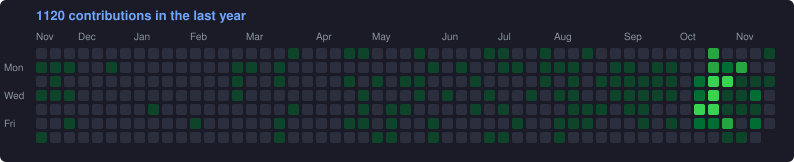

<b>English</b> · <a href="./README.es.md">Español</a>

<h1 align="center">Hi, I'm Juan Toranzos 👋</h1>

  Full Stack Developer from Argentina. I build web apps with React, Next.js and Node.js.

  
  
  

---

## 🧩 Projects

| Project | Description | Stack | Link |
|---------|-------------|-------|------|
| **Qarta** | Point of sale (POS) system for restaurants and bars, with digital QR menus | TypeScript · Next.js | [qartaqr.com](https://qartaqr.com) |
| **Next Level** | Online store for imported tech products in Argentina | Full stack e-commerce | [nextlevelargentina.store](https://nextlevelargentina.store) |
| **Cosmic Kid** | Official site for the artist Cosmic Kid with their 2026 tour dates and tickets | HTML · CSS · JavaScript | [cosmickid.com.ar](https://cosmickid.com.ar) |
| **Construcciones Civiles** | Website for a mining infrastructure and logistics company in northwest Argentina | Next.js | [construccionesciviles.com](https://construccionesciviles.com) |

## 🛠️ Tech stack

  
  
  
  
  
  
  
  
  
  
  

## 📊 GitHub activity

  

  
  

